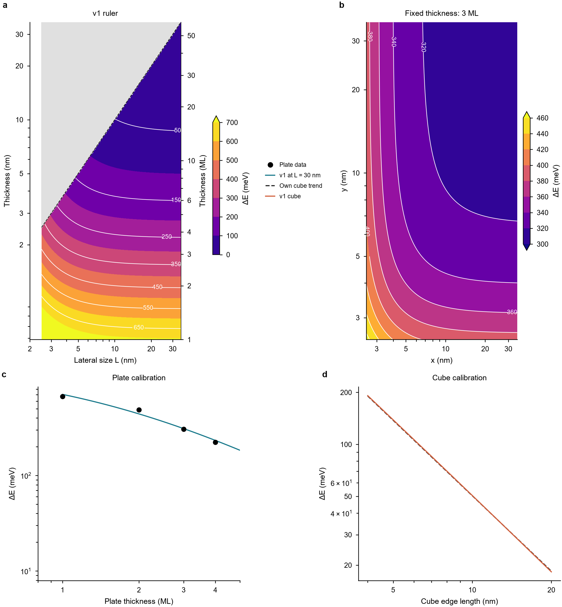

# Figure gallery

Current state of all figures. One row per figure; newest version only.

| ID | Preview | Caption | Script | Updated |
|---|---|---|---|---|
| demo |  | Style demo (delete after M0) | `scripts/fig_template.py` | 2026-11-24 |
| F1 |  | v1 energy ruler, fixed-thickness section, and plate/cube calibration checks | `scripts/fig_f1_ruler.py` | 2026-11-24 |
| F2 |  | Corner projections of all library morphology populations | `scripts/fig_f2_library.py` | 2026-11-24 |
| F3 |  | Population, brightness, weighted density, sparse binning entries, and energy spectrum | `scripts/fig_f3_pipeline.py` | 2026-11-24 |
